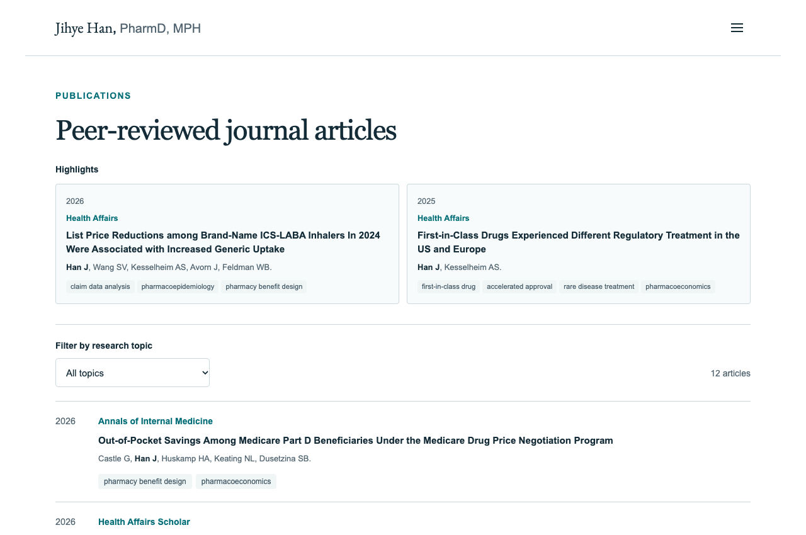

## A website that helps people find your work

- **Who are you?** Your role, affiliation, and research focus.
- **What do you study?** Questions people outside your specialty can understand.
- **Where is the evidence?** Publications and your CV.
- **How can someone reach you?** Email and professional profiles.

Today: **create with AI**, then **maintain it yourself**.

::: {.notes}
0:30–1:15. A visitor may be a collaborator, a hiring committee member, a journalist, or another student. Plan around the information that visitor needs. A short, accurate site is enough to start. Optional sections can wait until there is real content.
:::

## www.jihyehan.com

:::: {.columns}
::: {.column width="62%"}
{.screenshot width=760 fig-alt="Homepage showing research focus, profile photo, publications and CV links"}
:::
::: {.column width="38%"}
**A few deliberate choices**

- Separate research, publications, and media pages
- CV access from the main navigation
- Email, Scholar, and LinkedIn links
- Navy text, teal accents, generous space

[Visit the website](https://jihyehan.com)
:::
::::

::: {.notes}
1:15–2:15. The site uses the home page to introduce the researcher, then gives research questions and publications their own space. The screenshot comes from the current repository build. The optional /cv/ page offers view and download buttons, while the main CV navigation opens the PDF directly. The design uses #142c38 text and #006d77 teal. Avoid adding empty sections just to fill a template.
:::

## Part 1: creating the website

| Step | Your job | AI's job |
|---|---|---|
| 1. Prepare | Supply verified content | Identify missing fields |
| 2. Specify | Choose pages and visual style | Build an editable first draft |
| 3. Review | Check facts and try every link | Fix specific problems |
| 4. Publish | Own the account and domain | Document the build process |

::: {.tip}
**Tips.** Ask for maintainable files and an editing guide in the first or final prompt.
:::

::: {.notes}
2:15–3:05. We can make the process more efficient by agreeing on structure and editing locations up front. AI can produce code, but the researcher remains responsible for the biography, publication records, and permissions to share materials. Ask the tool to explain where future edits belong before calling the site finished.
:::

## The content packet

:::: {.columns}
::: {.column width="50%"}
**Prepare**

- Short bio and affiliation (for cover page)
- Public CV and a headshot (for cover or a separate CV page)
- 2–4 research questions (optional, for "Research" page)
- Verified citations and DOI links (for publication page)
:::
::: {.column width="50%"}
**Decide**

- Optional sections
- Contact and profile links
- Colors, type, and example layouts
:::
::::

::: {.notes}
3:05–3:50. The resource folder contains a worksheet to assemble this packet. Optional teaching, software, datasets, and news sections are useful when there is something current to show. Keep the site's descriptions consistent with your CV. Do not ask the model to fill gaps by guessing.
:::

## A prompt that specifies the result

::: {.small}
> Build a professional academic website for a PhD student using the attached verified content. Create Home, Research, Publications, Media, and CV pages. Use charcoal `#292524`, terracotta `#9A3412`, and an ivory `#FFFBF5` background. Use sans-serif headings, a left sidebar on desktop, and a top menu on mobile.
>
> Include DOI links, topic filters linked from research questions, and accessible navigation. Keep publication records in one editable data file. Do not invent facts. Flag missing information.
>
> Deliver the source files, preview/build commands, GitHub Pages instructions, and a file-by-file editing guide. Show me how to add one paper and replace my CV without AI.
:::

::: {.tip}
**Tips.** Use the [full copy-and-paste prompt in the appendix](#a3-full-creation-prompt).
:::

::: {.notes}
3:50–5:00. This is an abbreviated prompt. The appendix adds exact fields, interaction behavior, metadata, accessibility, and acceptance checks. Tell a coding assistant to implement the site in your project folder. If using an ordinary chat interface, ask for complete named files and instructions for saving them. Avoid repeatedly asking to make it more professional. State what needs to change and how you will judge it.
:::

## Useful features (optional)

:::: {.columns}
::: {.column width="57%"}
{.screenshot width=700 fig-alt="Publication page showing selected articles and a research-topic dropdown"}
:::
::: {.column width="43%"}
- **DOI links:** article titles open the published paper.
- **Topic links:** a research keyword opens the matching papers.
- **Filtering:** clearing the filter restores all papers.
:::
::::

::: {.notes}
5:00–6:00. Research keywords open matching publication filters. Clearing the filter restores the list, and browser Back restores the previous selection. The article count, empty state, keyboard controls, PDF links, and DOI destinations each provide a concrete check of the finished site.
:::

## Publishing and an optional domain

**GitHub stores the project. GitHub Pages serves the built website.**

1. Create your own `USERNAME.github.io` repository.
2. Run `npm run build`, then publish the generated `docs/` folder from `main`.
3. Check the free GitHub Pages address.
4. Optional: buy a domain through GoDaddy and connect it using DNS.

::: {.tip}
**Tips.** Ask AI for step-by-step instructions to verify domain ownership, connect it in GitHub Pages, add the DNS records, and enable HTTPS.
:::

::: {.notes}
6:00–7:10. This uses the workflow in my site: npm run build regenerates docs, then a push publishes it. A GitHub repository URL is different from the public website URL. My domain purchase happened separately through GoDaddy. A domain is optional and renews periodically. You do not need to buy GoDaddy hosting for this GitHub Pages workflow. DNS details and official links are in A8–A9. Sources: https://docs.github.com/en/pages/getting-started-with-github-pages/creating-a-github-pages-site and https://docs.github.com/en/pages/getting-started-with-github-pages/configuring-a-publishing-source-for-your-github-pages-site and https://docs.github.com/en/pages/configuring-a-custom-domain-for-your-github-pages-site/managing-a-custom-domain-for-your-github-pages-site
:::

## Part 2: maintaining the website yourself

| What changes? | Where you edit in this site |
|---|---|
| Bio, role, contact links | `app/page.tsx` |
| Research questions | `app/research/page.tsx` |
| Publication records | `app/publications.json` |
| Media coverage | `app/media/page.tsx` |
| CV PDF and headshot | `public/` |
| Colors; shared metadata and footer | `app/globals.css`; `app/layout.tsx` |

::: {.small}
**Build = turn your edited files into website files.** In VS Code, open your website folder, choose **Terminal > New Terminal**, and run:

```bash
npm run build
```

This command generates `docs/`, the folder GitHub Pages displays online.
:::

::: {.tip}
**Tips.** Edit the files above. Changes made directly in `docs/` disappear the next time you build.
:::

::: {.notes}
7:10–8:15. JSX files combine text and HTML-like tags. JSON holds structured publication data. CSS controls appearance. The public folder contains files that the build copies to the website. We do not edit generated docs files by hand because the next build will replace them. The case-study framework is React/TypeScript with a vinext build. Attendees can choose another framework, but their file map must match their actual project.
:::

## New publications

```json
{
  "id": 13,
  "authors": "YOUR-NAME, COAUTHOR-NAME",
  "title": "YOUR ARTICLE TITLE",
  "journal": "YOUR JOURNAL",
  "year": "2026",
  "doi": "REPLACE_WITH_VERIFIED_DOI",
  "topics": ["health equity"]
}
```

::: {.tip}
**Tips.** Add the record to `app/publications.json` with a unique ID. Separate it from the next record with a comma.
:::

::: {.notes}
8:15–9:30. Each record needs a unique ID. The DOI field contains the identifier without https://doi.org/, because the page adds the prefix. JSON uses straight double quotes. Topic spelling matches the dropdown options exactly. The order of records in this file determines their order on the page.
:::

## CV replacement

1. Export a new, public version of your CV as PDF.
2. Replace `public/YOUR-NAME-CV.pdf` using the **same filename**.
3. Update the footer date in `app/layout.tsx`.
4. Preview the site and open the PDF from each CV link.

::: {.tip}
**Tips.** Keep the same PDF filename so existing CV links continue to work.
:::


::: {.notes}
9:30–10:20. This is a useful first maintenance exercise. Check page count and first page so a cached PDF does not fool you. Similar logic applies to the headshot. If your affiliation changes, also update the homepage, footer, page description, and social preview metadata. These are separate copies in the case-study code.
:::

## The update routine: preview your changes

::: {.workflow}
1. In VS Code, open your **website folder** containing `package.json`. Choose **Terminal > New Terminal**. Before editing, run:

```bash
git status
git pull --ff-only
npm run dev
```

2. Open the **local URL printed in the terminal** in your browser, for example `http://localhost:3000`. Keep the terminal running.
3. Edit a source file in VS Code and **save it**. Return to the browser and refresh. Open the changed page and try its links or CV download.
4. When the change looks right, click inside the **VS Code terminal** and press **Ctrl+C** to stop the preview.
:::

::: {.tip}
**Tips.** The local preview is visible on your computer. Follow the next slide to publish it. Pull only when `git status` shows no unfinished changes.
:::

::: {.notes}
10:20–12:00. The terminal is a panel inside VS Code. It stays open while the local preview is running. The URL appears after npm run dev starts and may use a port other than 3000. Copy the complete printed address into the browser. Save the actual source file, then revisit the relevant page in the preview. Ctrl+C goes in the terminal, not in the browser. This ends the local preview process without deleting saved edits.
:::

## The update routine: build and publish

::: {.workflow}
1. In the same terminal, run these commands **one at a time** for a publication update:

```bash
npm run lint
npm run build
git diff -- app/publications.json
git add app/publications.json docs
git commit -m "Add new publication"
git push
```

2. **Lint** checks the code; **build** generates `docs/`. Continue after both succeed. **Diff** shows your edits; **add** selects files; **commit** saves a version; **push** sends it to GitHub.
3. On GitHub, open the repository’s **Actions** tab. Wait for the Pages deployment to succeed. Open `https://USERNAME.github.io` or your custom domain, refresh, and check the updated page.
:::

::: {.tip}
**Tips.** For other updates, replace `app/publications.json` with the source files you changed. Include `docs/` so the website files reach GitHub too.
:::

::: {.notes}
12:00–14:00. The publication example stages the JSON file and generated website output together. For a CV and footer update, the source files are public/YOUR-NAME-CV.pdf and app/layout.tsx. A build prepares files on this computer. It does not upload them. git push sends the committed files to GitHub, where the existing Pages configuration publishes main /docs. Actions shows when that deployment completes. The final check uses the public address, not the localhost preview address.
:::

## Resources and discussion {#resources}

**Your first independent update:** replace a CV or add one publication, preview it, and publish it.

[GitHub resource folder](https://github.com/jihyehan-research/jihyehan-research.github.io/tree/main/resources/ai-personal-website)

[Open the step-by-step guide](guide.html) · [Jump to the appendix](#a1-setup-and-terms)

**Questions and discussion: up to 10 minutes**

::: {.notes}
14:00–15:00. AI helps create the first implementation. A clear file structure makes routine updates manageable independently. The linked resources include the complete prompt, coding guide, content worksheet, update checklist, and publication validator.
:::

# Step-by-step coding guide

Take-home appendix. Also available as a [continuous reading guide](guide.html).


